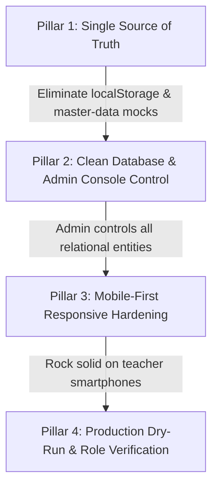

# Prototype to Production Master Roadmap & Execution Strategy

> **Document**: `doc/plans/2026-10-18-prototype-to-production-master-roadmap.md`  
> **Status**: Approved Strategy & Master Blueprint  
> **Target System**: LabSync LIMS / LMR  
> **Context**: Transitioning from prototype dev scaffolding (`localStorage`, JSON blobs, and `lib/master-data.ts` mock fallbacks) into an enterprise-grade, single-source-of-truth PostgreSQL production system.

---

## 1. Executive Summary & Forensic Diagnosis

During rapid early development, many user interfaces were wired to static fallback arrays in [`lib/master-data.ts`](file:///d:/Projects/LMR/lib/master-data.ts) and client-side caching hooks in [`hooks/use-infrastructure-state.ts`](file:///d:/Projects/LMR/hooks/use-infrastructure-state.ts) and [`hooks/use-routine-state.ts`](file:///d:/Projects/LMR/hooks/use-routine-state.ts). 

Meanwhile, a normalized PostgreSQL relational database was built with real tables:
- `public.profiles` (Teacher & Admin Accounts)
- `public.subjects` (29 Real Curriculum Subjects)
- `public.classes` (9 Grade & Cohort Batches)
- `public.class_subjects` (Junction Mapping Class $\leftrightarrow$ Subject $\leftrightarrow$ Teacher)
- `public.schedules` (Institutional Weekly Timetable)
- `public.labs` (Computer, Physics, Chemistry Labs)
- `public.issue_categories` (Workstation & Equipment Faults)

### Root Causes of Reported Visual Anomalies:
1. **Messy Schedule Teachers (`COMP12-Teacher`, `CN12-Teacher`)**:
   - `lib/master-data.ts` contained an old 1,000-line prototype array (`MASTER_ROUTINE`) with dummy names.
   - `hooks/use-routine-state.ts` cached this into `localStorage['lab_master_routine_2083_v6']`.
   - `app/(dashboard)/schedules/page.tsx` merged these mock names with real profiles, creating a cluttered dropdown.
2. **Records Subject Filter Capped at 11 (`All Subjects (11)`)**:
   - `components/records/practical-filter-bar.tsx` used `useInfrastructureState().subjects`, which fell back to the 11 hardcoded subjects in `DEFAULT_SUBJECTS`.
   - The **29 active curriculum subjects** in `public.subjects` were completely bypassed.
3. **Duplicate Teacher Bug (*Dinanath Shah*)**:
   - `app/actions/logs.ts` (`getTeachers()`) queried `SELECT id, full_name FROM profiles` without filtering `approval_status = 'approved'` and `is_active = true`.
   - Dinanath had two accounts (one `rejected` test account and one `approved` active account), causing him to appear twice. Non-teachers (Super Admin, HOD) also leaked into the list.
4. **Admin Console Split-Brain**:
   - When administrators added/edited classes or subjects in `/admin` (Tab 02 Curriculum), the code saved into serialized JSON blobs in `institution_settings` (`infrastructure_subjects`, `infrastructure_classes`) and `localStorage`, rather than updating `public.subjects` or `public.classes`.

---

## 2. The 4-Pillar Production Roadmap



### Pillar 1: Single Source of Truth (Kill the Shadow Data Layer)
- Sever all frontend hooks from `lib/master-data.ts` fallback arrays (`DEFAULT_CLASSES`, `DEFAULT_SUBJECTS`, `MASTER_ROUTINE`, `INITIAL_FACULTY`, `LAB_ROOMS`).
- Bind every dropdown, filter, and selector directly to PostgreSQL tables via typed Server Actions.
- Evict all legacy `lmr_admin_*` and `lab_master_routine_*` cache keys from browser `localStorage`.

### Pillar 2: Clean Database & Admin Console Control
- **Full Relational Mapping**: Admin Console Tab 02 (Curriculum) directly mutates `public.subjects`, `public.classes`, and the junction table `public.class_subjects`.
- **Soft Deactivation (`is_active = false`)**: Prohibit hard deletes on entities referenced by `practical_logs`, `schedules`, or `student_enrollments` to prevent PostgreSQL foreign key crashes (`23503`) or historical attendance wipeout.
- **Server Action RBAC**: Every mutating action enforces strict server-side authorization (`super_admin`, `lab_incharge`, `hod`) with Next.js cache revalidation (`revalidatePath`).

### Pillar 3: Mobile-First Responsiveness for Practical Operations
- **`/records/new` (Session Logging)**: Single-column responsive layout with sticky bottom thumb action bar ("Save & Submit Practical Log").
- **`/computer-lab` (Live Cockpit)**: High-speed mobile workstation cards with 1-tap Present/Absent pills and Quick Relocate.
- **`/records`**: Responsive card-stack view (`hidden md:table`) eliminating 800px horizontal table scrolling.
- **`/incidents`**: Standard `<input type="file" accept="image/*" />` enabling native choice between live camera snapshot and existing gallery photo.
- **`/schedules`**: Day-by-Day swipeable tab view on mobile devices.

### Pillar 4: Role-Based Dry-Run & Production Handover
- Execute end-to-end dry-run workflows across all 4 institutional roles:
  1. **Teacher**: Schedule view &rarr; Session roll-call &rarr; Save log &rarr; Report incident.
  2. **Lab In-Charge**: Attendance ledger audit &rarr; Workstation triage &rarr; Fault resolution &rarr; Official NEB Excel export.
  3. **Head of Department (HOD)**: Departmental log audit &rarr; Incident escalations &rarr; Syllabus progress check.
  4. **Super Admin**: Curriculum management &rarr; Timetable slot reconfiguration &rarr; Multi-year cohort promotion.

---

## 3. Division of Responsibilities

| Antigravity (Core AI Assistant) | User (Institutional Admin / Product Lead) |
| :--- | :--- |
| **Code Refactoring**: Write canonical server actions, delete fallback arrays, eliminate `localStorage` shadow stores. | **Institutional Policy**: Confirm real school subjects, class names, and teacher account approvals. |
| **Database Migrations & Actions**: Implement soft-delete guards, relational junction actions (`class_subjects`), and strict RBAC guards. | **Roster Verification**: Sanity check real teacher and student names once dropdowns are rewired. |
| **Mobile UX Engineering**: Refactor responsive CSS, sticky thumb bars, card views, and mobile camera pickers. | **Physical Mobile Testing**: Open routes on a smartphone to test thumb reach and usability. |
| **Automated Verification**: Run strict TypeScript checks (`npx tsc --noEmit`) and integration test suites. | **Final Sign-off**: Perform the persona dry runs before live production deployment. |

---

## 4. Master 5-Phase Implementation Breakdown

```
Phase 1: Canonical Database Actions & Relational Mapping
   ↓ (subjects.ts, classes.ts, getTeachers sanitization, class_subjects junction actions, soft-delete guards)
Phase 2: Admin Console Unification
   ↓ (/admin Tab 02 directly controls public.subjects, public.classes, public.class_subjects)
Phase 3: Client Hooks & UI Dropdown Purge
   ↓ (Filters on /records, /schedules, and session modals rewired to live DB; COMP12-Teacher eradicated)
Phase 4: Mobile Responsiveness Pass
   ↓ (/records/new, /computer-lab, /records, /schedules, /incidents hardened for smartphones)
Phase 5: Full System Dry-Run & Production Handover
     (Role-by-role end-to-end verification, test password purge, final launch sign-off)
```
