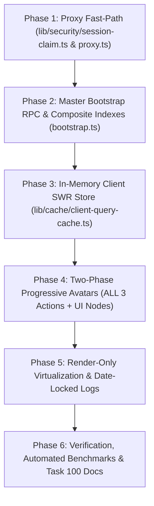

# LabSync LIMS: Master Speed Architecture & Reliability Implementation Plan (Hardened & Complete)

> **Authoritative Technical Document & Risk Guard**: Combines Initiative 2 (Bootstrap & Latency Optimization) and Initiative 3 (Hybrid SWR & Client-Side Rendering) into a unified, zero-latency performance overhaul. Incorporates Gemini Argon speed architecture guidelines, **5 Critical Security & Correctness Guards**, and **3 Missing Pieces (Composite Indexes, Singleton Avatar Cache, and Upload Compression)** with a strict file-by-file wiring contract.

---

## Part I: System-Wide Performance & Data Architecture Audit

### 1.1 Executive Summary of Current Latency Bottlenecks

The 10–15 second UI freeze is caused by an **architectural impedance mismatch** between Next.js 16 Server-Side Rendering (SSR) waterfalls, Supabase PostgREST cloud latency over public WAN, and unbounded database JSON payloads:

```
[User Clicks Sidebar Tab]
       │
       ▼ (1.5s - 3.2s)
[Next.js proxy.ts / Middleware] ──> Supabase Auth API (getUser) ──> PostgREST (public.profiles query)
       │
       ▼ (2.0s - 4.5s)
[Server page.tsx] ──> 6 to 10 Sequential Server-Side Awaits (getPgPool & Supabase REST)
       │
       ▼ (3.5s - 6.0s)
[Client Initial Mount] ──> 12 Concurrent Client Server Actions (useInfrastructureState, useLogsState, etc.)
       │                   + Unbounded photo_url strings (400KB+ base64/long URLs)
       │                   + Full table scan on practical_logs (all historical records in school history)
       ▼
[DOM Rendering] ──> 500+ unvirtualized <tr> / <div> nodes rendered simultaneously ──> UI Freeze (10-15s total)
```

---

### 1.2 The 5 Systemic Root Causes & Their Locations

1. **Blocking `proxy.ts` WAN Round-Trips on Every Navigation Click** ([`proxy.ts:74-110`](file:///d:/Projects/LMR/proxy.ts#L74-L110)):
   - Every click on `/admin`, `/maintenance`, or route redirects triggers two sequential WAN HTTPS calls to `https://<ref>.supabase.co/auth/v1/user` and `https://<ref>.supabase.co/rest/v1/profiles`.
   - Introduces **1,500ms to 3,200ms** of mandatory latency before Next.js even begins evaluating the target page.
2. **12-Action Client Mount Waterfall** ([`hooks/use-infrastructure-state.ts:390-520`](file:///d:/Projects/LMR/hooks/use-infrastructure-state.ts#L390-L520)):
   - When any primary page mounts, 12 independent Server Actions execute concurrently. Under concurrent load, the 20-connection pool (`lib/db.ts:32`) experiences connection starvation and queuing, delaying execution by **3,000ms to 5,500ms**.
3. **Heavy `photo_url` Payloads Blocking Text** ([`app/actions/students.ts`](file:///d:/Projects/LMR/app/actions/students.ts), [`app/actions/live-session.ts`](file:///d:/Projects/LMR/app/actions/live-session.ts), [`app/actions/seat-plans.ts`](file:///d:/Projects/LMR/app/actions/seat-plans.ts)):
   - Roster, live session, and CAD seat plan queries directly fetch `s.photo_url` inside bulk student collections. If 40–80 students have photos, the JSON payload balloons to **350KB–800KB**, delaying initial text display by **1,200ms to 2,400ms**.
4. **Full Historical Table Scans on Practical Logs** ([`app/actions/logs.ts:858`](file:///d:/Projects/LMR/app/actions/logs.ts#L858) & [`hooks/use-logs-state.ts:204`](file:///d:/Projects/LMR/hooks/use-logs-state.ts#L204)):
   - `getPracticalLogs()` pulls the entire historical logbook into client memory without pagination or date boundaries.
5. **Unvirtualized DOM Node Multiplication** ([`components/roster/class-roster-view.tsx:951`](file:///d:/Projects/LMR/components/roster/class-roster-view.tsx#L951)):
   - Renders 200–400 complex DOM rows and image decoders simultaneously across desktop and mobile, dropping scroll performance to **~18 FPS**.

---

## Part II: The 5 Critical Invariants & 3 Missing Pieces

### Missing Piece A: PostgreSQL Composite Indexes for High-Velocity Queries
- Create composite B-Tree indexes:
  - `student_enrollments (academic_year_id, class_id, status, roll_number)`
  - `workstation_seat_plans (class_id, academic_year_id)`
  - `practical_logs (date, schedule_id)`
- Prevents database sequential table scans as enrollment and log records scale over the multi-year academic lifecycle.

### Missing Piece B: Module-Level Singleton Avatar Cache
- In `computer-lab-workspace.tsx:821`, `refreshLiveSessionAndBoard()` polls every 10 seconds.
- `useDeferredAvatars` MUST be backed by a persistent module-level singleton `Map<string, string | null>` outside the React component lifecycle so that once a student's avatar is loaded into RAM, it stays in RAM across tab switches and never flickers or re-fetches during the 10-second auto-sync!

### Missing Piece C: Preventing Base64 Bloat & Upload Optimization
- `getStudentAvatarsBatch` fetches at most 10–15 IDs per batch.
- Provide client-side image compression (`lib/image-compress.ts`) using HTML5 Canvas (`image/webp`, quality 0.75, max 256x256px, < 20KB) for student and equipment photo uploads to prevent bloated payloads from ever entering PostgreSQL.

### Guard 1: Comprehensive CAD Floor Plan & Live Cockpit Photo Stripping
- Strip `photo_url` across ALL 3 endpoints: `app/actions/students.ts`, `app/actions/live-session.ts`, and `app/actions/seat-plans.ts`.
- Wire `<ProgressiveAvatar />` directly into `components/maintenance/workstations/workstation-node.tsx` so the 48 CAD monitor nodes load text and monograms in `< 50ms`.

### Guard 2: Today's Session State & Skip Detection Protection in `useLogsState`
- Always fetch 100% of logs matching the active / simulated date (`SELECT * FROM practical_logs WHERE date = $1`) alongside the 50 recent historical items.
- Return fast SQL `COUNT(*)` aggregates (`totalCount`, `conductedCount`, `skippedCount`) so KPI cards show true totals.

### Guard 3: User ID Binding & Cross-Account Bleed Defense
- HMAC claim payload MUST bind to `uid` (Supabase Auth User ID / JWT `sub`).
- In `proxy.ts`, extract `sub` from the incoming auth cookie; if `cookieSub !== claim.uid`, immediately invalidate `labsync_session_claim`. Clear on sign-out and administrative role updates.

### Guard 4: Strict Session Scoping & RLS Defense on Master Bootstrap RPC
- `getLabSyncBootstrapData()` verifies `getServerUserScope()` at line 1. Rejects unauthenticated or unapproved users.
- Sanitizes profile columns: strictly select `id, full_name, email, role, department` (never select passwords, pairing tokens, or audit internals).

### Guard 5: Windowed Slicing strictly on Render (Zero Search/Filter Breakage)
- Search query, class filtering, status filtering, sorting, and "Select All" MUST operate on 100% of the in-memory array (`filteredStudents`).
- `useInfiniteSlice` is applied **strictly to the JSX `.map()` render tree**.

---

## Part III: Strict File-by-File Implementation Contract



---

## Part IV: Step-by-Step Task Breakdown

### Phase 1: Proxy Fast-Path Session Cookie Cache with User ID Binding
- [ ] **Task 1.1**: Create `lib/security/session-claim.ts`
  - Implement Web Crypto API (`crypto.subtle`) HMAC-SHA256 signing and verification for `labsync_session_claim` (5-minute TTL).
  - Payload: `{ uid: string, role: string, approvalStatus: string, isActive: boolean, labScope?: string, exp: number }`.
- [ ] **Task 1.2**: Update `proxy.ts`
  - Extract Supabase Auth user ID (`sub`) from incoming request session cookies.
  - If `labsync_session_claim` is valid, unexpired, and `claim.uid === currentAuthSub`, bypass `supabase.auth.getUser()` and `profiles` query entirely (<0.2ms).
  - When fast-path misses or expires, execute standard verification and write the freshly signed `labsync_session_claim` HttpOnly cookie onto `NextResponse`.
- [ ] **Task 1.3**: Update `app/actions/auth.ts`
  - Clear `labsync_session_claim` on `signOutAction`.
  - Issue `labsync_session_claim` on `signInAction`.
  - Clear claim in `app/actions/users.ts` / `app/actions/admin.ts` when a user's role or status changes.
- [ ] **Task 1.4**: Run `npx tsc --noEmit` and verify 0 type errors.

---

### Phase 2: Master Bootstrap RPC & Composite PostgreSQL Indexes
- [ ] **Task 2.1**: Ensure composite indexes exist via migration / idempotent pool script:
  - `student_enrollments (academic_year_id, class_id, status, roll_number)`
  - `workstation_seat_plans (class_id, academic_year_id)`
  - `practical_logs (date, schedule_id)`
- [ ] **Task 2.2**: Create `app/actions/bootstrap.ts`
  - Line 1: `const scope = await getServerUserScope()`. Reject if `!scope.userId || scope.approvalStatus !== 'approved'`.
  - Execute a single consolidated SQL query using `getPgPool()` (`jsonb_build_object`) fetching: `academicYears`, `labs`, `classes`, `subjects`, `classSubjects`, `periods`, `teachers` (sanitized), `holidays`, `incidentCategories`.
- [ ] **Task 2.3**: Update `hooks/use-infrastructure-state.ts`
  - Replace the 9–12 mount Server Action calls with a single call to `getLabSyncBootstrapData()`.
  - Retain mutation actions for targeted updates.
- [ ] **Task 2.4**: Run `npx tsc --noEmit` and verify 0 type errors.

---

### Phase 3: Client In-Memory SWR Store
- [ ] **Task 3.1**: Create `lib/cache/client-query-cache.ts`
  - In-memory cache singleton (`Map<string, { data, timestamp, promise }>`) with `useClientQuery(key, fetcher, options)`.
  - Instant return on first render frame (0ms) if data exists in memory; silent background revalidation if stale.
  - Connect to `subscribeToSync` in `lib/sync-bus.ts` to invalidate matching cache prefixes on mutations.
- [ ] **Task 3.2**: Wire `client-query-cache.ts` into:
  - `hooks/use-infrastructure-state.ts`
  - `hooks/use-logs-state.ts`
  - `components/computer-lab/computer-lab-workspace.tsx` (cache board data & live session by scheduleId + date for 0ms floor plan tab switches).
- [ ] **Task 3.3**: Run `npx tsc --noEmit` and verify 0 type errors.

---

### Phase 4: Two-Phase "Text-First, Avatar-Second" Loader Across ALL 3 Actions & CAD Floor
- [ ] **Task 4.1**: Strip `photo_url` across all 3 student endpoints:
  - `app/actions/students.ts` (`getStudentsByClass`): Select `(s.photo_url IS NOT NULL AND s.photo_url != '') AS has_photo`, set `photo_url: null`.
  - `app/actions/live-session.ts` (`getLiveSessionContext`): Strip `photo_url` from initial student_enrollments join; set `hasPhoto: boolean` and `photoUrl: null`.
  - `app/actions/seat-plans.ts` (`getLabSeatPlan`): Strip `photo_url`, return `has_photo: boolean`.
- [ ] **Task 4.2**: Add `getStudentAvatarsBatch(studentIds: string[])` to `app/actions/students.ts` using `getPgPool()` (`WHERE id = ANY($1::uuid[])`), chunked to max 15 IDs.
- [ ] **Task 4.3**: Create `hooks/use-deferred-avatars.ts`
  - Persistent module-level singleton `Map<string, string | null>` outside React component state to prevent avatar refetching or flickering during 10-second auto-sync polls.
- [ ] **Task 4.4**: Create `components/ui/progressive-avatar.tsx`
  - Renders monogram initials instantly; streams photos via `IntersectionObserver` when visible.
- [ ] **Task 4.5**: Create `lib/image-compress.ts` client-side image compression utility (< 20KB WebP) for uploads.
- [ ] **Task 4.6**: Wire `<ProgressiveAvatar />` into:
  - `components/roster/class-roster-view.tsx`
  - `components/maintenance/workstations/workstation-node.tsx` (the 48 CAD monitor nodes)
  - `components/computer-lab/computer-lab-workspace.tsx` (popover/drawers)
- [ ] **Task 4.7**: Run `npx tsc --noEmit` and verify 0 type errors.

---

### Phase 5: Render-Only Virtualization & Date-Locked Logs
- [ ] **Task 5.1**: Create `hooks/use-infinite-slice.ts`
  - `useInfiniteSlice(items, initialLimit = 20, step = 20)` with `sentinelRef`.
  - Invariant: Applied **strictly to JSX `.map()` render tree**. Search, filter, sorting, and "Select All" run on 100% of the in-memory cohort.
- [ ] **Task 5.2**: Wire `useInfiniteSlice` into `components/roster/class-roster-view.tsx` (table body and mobile list).
- [ ] **Task 5.3**: Update `app/actions/logs.ts` and `hooks/use-logs-state.ts`
  - `getPracticalLogs({ limit = 50, offset = 0, effectiveDate?: string })`:
    - 100% of logs for `effectiveDate` (`WHERE date = $1`).
    - Merged with 50 recent historical logs.
    - Accurate SQL `COUNT(*)` aggregates (`totalCount`, `conductedCount`, `skippedCount`).
  - Wire into `hooks/use-logs-state.ts` so skip detection, completion checks, and KPI cards never desync.
- [ ] **Task 5.4**: Run `npx tsc --noEmit` and verify 0 type errors.

---

### Phase 6: Mandatory Verification & Proof of Wiring
- [ ] **Task 6.1**: Run `npx tsc --noEmit` (strict 0 errors).
- [ ] **Task 6.2**: Run test suite `tests/performance-bootstrap-and-cache.test.mjs` and existing test suites.
- [ ] **Task 6.3**: Print Proof of Wiring: List exact line numbers in `proxy.ts`, `hooks/use-infrastructure-state.ts`, `app/actions/live-session.ts`, `app/actions/seat-plans.ts`, `app/actions/students.ts`, `workstation-node.tsx`, and `class-roster-view.tsx`.
- [ ] **Task 6.4**: Record Task 100 logbook entry in `doc/tasks/` and update `doc/tasks/README.md`.
