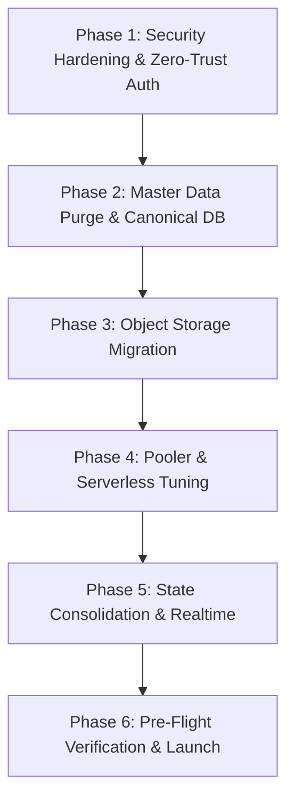

# Full System Audit & Production Readiness Roadmap

> **Document**: `doc/plans/FULL_SYSTEM_AUDIT_AND_PRODUCTION_ROADMAP.md`  
> **Type**: Architecture, Security & Operational Audit Report  
> **Status**: Comprehensive Audit Completed (Read-Only Analysis — Zero Code Modified)  
> **Target Environment**: Academic Laboratory Practical & Management System (LabSync LIMS / LMR)

---

## 1. Executive Summary & Readiness Scorecard

A full architectural, security, database, and front-end audit of the **LabSync LIMS / LMR** codebase was performed. The platform contains a mature set of academic workflows—including Class 11/12 practical logs, NEB 75% attendance compliance analytics, CAD workstation layouts, dual-date Bikram Sambat integration, and preventive maintenance routines. Strict TypeScript compilation passes with **0 type errors** (`npx tsc --noEmit`).

However, the codebase currently contains **critical security bypasses, hardcoded mock datasets, direct database auth manipulation, base64 image bloat, and browser-side split-brain state** that must be resolved prior to deploying to a live production environment.

### Production Readiness Index

```
┌────────────────────────────────────────────────────────┬────────┬─────────────────────────┐
│ Evaluation Dimension                                   │ Score  │ Production Status       │
├────────────────────────────────────────────────────────┼────────┼─────────────────────────┤
│ 1. TypeScript Strictness & Type Safety                 │ 100%   │ ✅ Ready (0 errors)     │
│ 2. Database Schema & Relational Integrity              │  85%   │ ⚠️ Minor gaps (1 un-RLS)│
│ 3. Security, Authentication & Role Governance (RBAC)   │  40%   │ 🚨 High Risk (Bypasses) │
│ 4. Single Source of Truth (Zero Hardcoded Data/Mocks)  │  45%   │ 🚨 High Risk (Mocks)    │
│ 5. Media & Asset Storage (Avatars / Incident Photos)   │  35%   │ 🚨 High Risk (Base64 DB)│
│ 6. Multi-User State Synchronization & Caching          │  50%   │ ⚠️ Split-Brain Storage  │
│ 7. Scalability & Serverless Connection Pooling         │  60%   │ ⚠️ Session Pooler Limit │
│ 8. Auditability, Disaster Recovery & Compliance        │  80%   │ 🟢 Good (Audit ledger)  │
└────────────────────────────────────────────────────────┴────────┴─────────────────────────┘
```

---

## 2. Critical Security Vulnerabilities (P0 — Must Fix Before Production)

### 2.1 `process.env.NODE_ENV === 'development'` Root Privilege Bypasses
- **Location**:
  - [`app/actions/workstations.ts:59`](file:///d:/Projects/LMR/app/actions/workstations.ts#L59) (`getAuthContext`)
  - [`app/actions/maintenance.ts:150`](file:///d:/Projects/LMR/app/actions/maintenance.ts#L150) (`getAuthorizedProfile`)
  - [`app/actions/terminal.ts:20`](file:///d:/Projects/LMR/app/actions/terminal.ts#L20) (`getAuthContext`)
  - [`app/actions/maintenance-fleet.ts:25`](file:///d:/Projects/LMR/app/actions/maintenance-fleet.ts#L25) (`getAuthorizedProfile`)
- **Vulnerability**:
  ```typescript
  const isPrivileged =
    scope.isPrivileged ||
    scope.role === 'super_admin' ||
    scope.role === 'lab_incharge' ||
    scope.role === 'hod' ||
    process.env.NODE_ENV === 'development' // 🚨 ROOT PRIVILEGE ESCALATION
  ```
- **Impact**: Any unauthenticated request or unprivileged user account (e.g. students or unauthorized teachers) is automatically granted full administrative and lab in-charge privileges if `NODE_ENV` is set to `development` or if the runtime environment does not inject `NODE_ENV=production`.
- **Production Requirement**: Remove `process.env.NODE_ENV === 'development'` from all authorization helper functions. Privileges must strictly depend on verified session tokens and `public.profiles.role`.

---

### 2.2 Direct Raw SQL Manipulation of Supabase `auth.users` & Connection Leaks
- **Location**: [`app/actions/auth.ts:156-238`](file:///d:/Projects/LMR/app/actions/auth.ts#L156-L238)
- **Vulnerabilities**:
  1. **Direct Raw Password Encryption in DB**: The code executes raw SQL:
     ```sql
     INSERT INTO auth.users (id, email, encrypted_password, ...)
     VALUES (gen_random_uuid(), $1, crypt($2, gen_salt('bf', 10)), ...);
     ```
     This bypasses Supabase GoTrue Auth API (`supabase.auth.admin.createUser`). If Supabase upgrades its internal authentication tables, auth triggers, or MFA columns, this query will fail or create orphaned identity rows.
  2. **Connection Leak on Failure**: Lines 157–158 open an unpooled `pg.Client()` via `await client.connect()`. If any error occurs before line 260 `await client.end()`, the client is never closed because there is no `finally` block. Under high sign-up volume or network timeouts, this exhausts PostgreSQL connections.
  3. **Department Field Persistence**: Line 198 and 248 continues to insert `'department'` into metadata and profiles during signup, conflicting with Rule #5 (zero department regressions).
- **Production Requirement**: Refactor account provisioning to use Supabase GoTrue Admin client (`createAdminClient().auth.admin.createUser()`) and ensure all raw connection handlers use pooled queries (`getPgPool().query()`) with `try...finally` resource cleanup.

---

### 2.3 Row-Level Security (RLS) Blindspots & Overly Permissive Policies
Direct inspection of PostgreSQL `pg_tables` and `pg_policies` revealed:
1. **Missing RLS**: Table `public.lab_layout_templates` has `rowsecurity = false`. It is completely unprotected by PostgreSQL RLS.
2. **Public `ALL` Permission on Critical Tables**:
   - `public.labs`: Policy `'Allow insert/update labs'` has role `{public}` and command `ALL`.
   - `public.schedules`: Policy `'Allow manage schedules'` has role `{public}` and command `ALL`.
   - **Impact**: Anyone with the public Supabase Anon key can insert, modify, or delete laboratory rooms and the entire school academic timetable via direct PostgREST calls.
3. **Public Read on Student & Workstation PII**:
   - Policies `'read_students_scoped'` and `'read_student_enrollments_scoped'` permit `{public}` read access. Unauthenticated scrapers can dump all student names, admission numbers, registration numbers, and roll calls.
- **Production Requirement**:
  - Run `ALTER TABLE public.lab_layout_templates ENABLE ROW LEVEL SECURITY;`.
  - Restrict write policies on `labs`, `schedules`, and `profiles` to `{authenticated}` with role verification (`auth.uid() IN (SELECT id FROM profiles WHERE role IN ('super_admin', 'lab_incharge'))`).
  - Restrict student roster reads to `{authenticated}` faculty members.

---

### 2.4 Middleware Fail-Open Behavior
- **Location**: [`middleware.ts:130-132`](file:///d:/Projects/LMR/middleware.ts#L130-L132)
- **Vulnerability**:
  ```typescript
  } catch (error) {
    // Fail-open gracefully on transient edge network errors
    console.warn('Middleware auth verification error:', error)
  }
  return response
  ```
- **Impact**: If Supabase's Auth API has high latency or returns a 502/503 during edge middleware execution, the middleware fails open, allowing unauthenticated requests into `/admin`, `/records`, and `/maintenance`.
- **Production Requirement**: Fail closed for administrative routes (`/admin/*`), redirecting to `/login?error=auth_service_unavailable` while allowing graceful fallback only for public landing pages.

---

### 2.5 Seed Scripts with Known Default Passwords
- **Location**:
  - [`scripts/sync-demo-passwords.mjs:35-41`](file:///d:/Projects/LMR/scripts/sync-demo-passwords.mjs#L35-L41)
  - [`scripts/setup-new-database.mjs:524-527`](file:///d:/Projects/LMR/scripts/setup-new-database.mjs#L524-L527)
  - [`scripts/test-client-login.mjs:31-36`](file:///d:/Projects/LMR/scripts/test-client-login.mjs#L31-L36)
- **Vulnerability**: Hardcoded seed passwords (`Admin@12345`, `Incharge@12345`, `Hod@12345`, `Teacher@12345`) for accounts `@rrl.edu.np`.
- **Production Requirement**: Exclude or purge these scripts from production environments. In production, the initial Super Admin account must be bootstrapped via environment variables (`ADMIN_INITIAL_EMAIL`, `ADMIN_INITIAL_PASSWORD`) and forced to change credentials upon first login.

---

## 3. Comprehensive Inventory of Hardcoded Data, Mocks & Static Fallbacks

| Category | File Path | Hardcoded Entities | Production Risk & Impact | Required Production Action |
| :--- | :--- | :--- | :--- | :--- |
| **Timetable Routine** | [`lib/master-data.ts`](file:///d:/Projects/LMR/lib/master-data.ts#L1289-L2197) | `MASTER_ROUTINE` (~1,000 lines of mock schedule items) | Overrides real database routines; used in search, notifications, and seeding. | Purge array; pull active weekly timetable solely from `public.schedules`. |
| **Faculty & Teachers** | [`lib/context/institutional-relationships.ts`](file:///d:/Projects/LMR/lib/context/institutional-relationships.ts#L21-L103) | `INSTITUTIONAL_TEACHERS`, `PROFILE_TEACHER_MAPPING` (UUIDs mapped to `t1`..`t5`) | New real faculty get `null` assignments because they are not in the hardcoded TS array. | Fetch teacher assignments and subjects dynamically from `public.class_subjects` & `public.schedules`. |
| **Academic Year Defaults** | [`class-roster-view.tsx`](file:///d:/Projects/LMR/components/roster/class-roster-view.tsx#L69), [`seat-planner-tab.tsx`](file:///d:/Projects/LMR/components/maintenance/workstations/seat-planner-tab.tsx#L59), [`cohort-promotion-wizard.tsx`](file:///d:/Projects/LMR/components/admin/cohort-promotion-wizard.tsx#L178), [`schedules.ts`](file:///d:/Projects/LMR/app/actions/schedules.ts#L700), [`institutional-reports.ts`](file:///d:/Projects/LMR/app/actions/institutional-reports.ts#L53) | Default year string `'2083'` hardcoded across 20+ files | When year switches to `2084`, UI stays locked to 2083 until re-coded. | Query `SELECT id FROM academic_years WHERE is_current = true` as the universal dynamic default. |
| **Laboratory Facility Defaults** | [`app/actions/workstations.ts:67`](file:///d:/Projects/LMR/app/actions/workstations.ts#L67), [`app/actions/logs.ts:106`](file:///d:/Projects/LMR/app/actions/logs.ts#L106), [`app/actions/records.ts:51`](file:///d:/Projects/LMR/app/actions/records.ts#L51), [`log-form.tsx:152`](file:///d:/Projects/LMR/app/(dashboard)/records/new/log-form.tsx#L152) | Default lab string `'comp'` hardcoded in 168+ places; `chosenLab.key === 'comp' ? ...` ternaries | Breaks multi-lab flexibility (Physics, Chemistry, Biology, Electronics). | Pass dynamic `lab_id` from route params or active facility selector; remove `'comp'` fallback. |
| **Mock Fallback Arrays** | [`lib/master-data.ts`](file:///d:/Projects/LMR/lib/master-data.ts), [`session-action-modal.tsx`](file:///d:/Projects/LMR/components/schedules/session-action-modal.tsx#L30), [`routine-manager.tsx`](file:///d:/Projects/LMR/components/admin/routine-manager.tsx#L40) | `LAB_ROOMS`, `DEFAULT_CLASSES`, `DEFAULT_SUBJECTS` | If admin renames a lab or edits class capacity in DB, UI falls back to stale static mock array. | Remove fallback arrays; UI must render database data or a skeleton loading state. |
| **Institutional Identity Discrepancies** | [`lib/institution.ts:7`](file:///d:/Projects/LMR/lib/institution.ts#L7) vs [`lib/mailer.ts:163`](file:///d:/Projects/LMR/lib/mailer.ts#L163) | "Ratna Rajya Laxmi Secondary School" vs "Radha Raman Secondary School" | Inconsistent institution names in official emails, letters, and printed logs. | Standardize to single dynamic config or database-backed `institution_settings` table. |
| **Command Palette Search** | [`components/command-palette.tsx:55`](file:///d:/Projects/LMR/components/command-palette.tsx#L55) | `MASTER_ROUTINE.filter(...)` | Search results return fake mock classes and fake teachers. | Connect command palette to PostgreSQL search action. |
| **Notification Digest Engine** | [`app/actions/notifications.ts:85`](file:///d:/Projects/LMR/app/actions/notifications.ts#L85) | `MASTER_ROUTINE.filter(...)` | Daily digest emails reflect mock data rather than scheduled classes. | Query `public.schedules` where `day_of_week = todayDayOfWeek`. |

---

## 4. Architectural, Scalability & Performance Weaknesses

### 4.1 Base64 Image Storage in Transactional PostgreSQL (Database Bloat)
- **Current State**:
  - [`components/roster/class-roster-view.tsx:586`](file:///d:/Projects/LMR/components/roster/class-roster-view.tsx#L586) and [`batch-photo-import-modal.tsx`](file:///d:/Projects/LMR/components/roster/batch-photo-import-modal.tsx) compress student face avatars into Base64 JPEG data URLs (`data:image/jpeg;base64,...`) and store them in `public.students.photo_url` (`TEXT`).
  - Incident damage evidence is also stored as Base64 strings in `public.lab_incidents.photo_url`.
- **Capacity Analysis & Quota Utilization**:
  - **Database Size**: `32 MB / 500 MB` (actual school data is ~3.8 MB; ~28 MB is PostgreSQL system catalogs, extensions, and WAL buffers).
  - **File Storage**: `0 / 1 GB` (completely unused 1,000 MB free object storage quota).
  - Storing 1,000 student avatars as Base64 in PostgreSQL rows inflates the database by 20–30 MB (+ TOAST & audit duplicates = 100 MB+), eating valuable database space.
  - In contrast, storing 1,000 WebP images in Supabase Storage takes only **~15 MB** in the 1 GB bucket (**1.5% of storage quota**), while the database stores only an 80-byte CDN URL (80 KB total).
- **Free Tier Lifecycle Rule (7-Day Inactivity Auto-Pause)**:
  - Supabase pauses free-tier projects after 7 consecutive days of inactivity (e.g. during extended Dashain/Tihar vacations). A periodic scheduled health check or documented 1-click restore keeps the system ready.
- **Production Solution**:
  - Configure Supabase Storage buckets: `avatars` and `incidents`.
  - Upload raw image files directly to the storage bucket via Supabase Client SDK or pre-signed URLs.
  - Store only lightweight CDN HTTPS links (e.g. `https://xyz.supabase.co/storage/v1/object/public/avatars/student_uuid.webp`) in PostgreSQL.
  - Run a one-time migration script `scripts/migrate-base64-to-storage.mjs` during the hardening phase.

---

### 4.2 Browser `localStorage` Split-Brain & Shadow Stores
- **Current State**:
  - Multiple client hooks maintain shadow data in `localStorage`:
    - `use-incident-state.ts` &rarr; `lmr_incidents_v2`
    - `use-logs-state.ts` &rarr; `lmr_logs_v2`
    - `use-infrastructure-state.ts` &rarr; `lmr_infrastructure_v2`
    - `lib/sync-bus.ts` &rarr; `labsync_event_*`
- **Why this fails in production**:
  1. **Multi-User Desynchronization**: In a real school with 20 teachers and 2 lab in-charges operating on different laptops and mobile devices, changes made on User A's machine are invisible to User B until a hard page reload occurs.
  2. **Stale Cache Overwrite**: Optimistic updates write directly to local storage. If a user has an outdated local storage cache, it can overwrite fresh database state.
- **Production Solution**:
  - Eliminate persistent offline shadow stores in `localStorage` for transactional records.
  - Rely on standard Server Actions with Next.js `revalidatePath` and Supabase Realtime WebSocket broadcast for live multi-user synchrony.

---

### 4.3 Database Connection Pool & Serverless Concurrency Mismatch
- **Current State**:
  - [`lib/db.ts:14`](file:///d:/Projects/LMR/lib/db.ts#L14) rewrites the Supabase URL to use port `5432` on `aws-0-ap-southeast-1.pooler.supabase.com` with `new Pool({ max: 10 })`.
- **Issues**:
  1. **Port 5432 is Session Mode**: Supabase's port 5432 pooler reserves a physical PostgreSQL connection for each client session. In serverless deployments (Vercel Next.js App Router lambdas), each function invocation spins up an isolated pool, quickly hitting the database's `max_connections` limit.
  2. **Hardcoded AWS Region**: Hardcoding `aws-0-ap-southeast-1.pooler.supabase.com` causes connection failures if the Supabase project is deployed in another region (e.g. `ap-south-1` Mumbai or `us-east-1`).
- **Production Solution**:
  - Connect to port **`6543` (Transaction Mode)** for all serverless queries, allowing hundreds of concurrent serverless lambdas to multiplex over a small set of backend connections.
  - Dynamically parse the pooler host directly from the user's provided `DATABASE_URL` environment variable without hardcoded region strings.

---

### 4.4 Development Time Simulator Engine
- **Current State**:
  - [`lib/time-simulator.ts`](file:///d:/Projects/LMR/lib/time-simulator.ts) allows client-side date/time spoofing (`setSimulatedTime`, `jumpToDayInActiveWeek`, `jumpToTimeOfDay`).
- **Risk**: If accessible in production, teachers or staff could manipulate their system clock or active period, creating falsified or backdated practical attendance logs.
- **Production Solution**: Wrap the time simulator UI and storage keys in strict `process.env.NODE_ENV !== 'production'` and super-admin-only debug flags.

---

## 5. Step-by-Step Strategic Production Migration Plan



### Phase 1: Security Hardening & Zero-Trust Authentication
1. **Remove Development Privilege Bypasses**:
   - In `app/actions/workstations.ts`, `maintenance.ts`, `terminal.ts`, and `maintenance-fleet.ts`, remove `process.env.NODE_ENV === 'development'` from `isPrivileged` calculations.
2. **Refactor Account Creation**:
   - In `app/actions/auth.ts`, replace raw SQL `crypt()` insertion into `auth.users` with the official Supabase GoTrue Admin API:
     ```typescript
     const { data, error } = await supabaseAdmin.auth.admin.createUser({
       email,
       password,
       email_confirm: true,
       user_metadata: { full_name: fullName, role },
     })
     ```
   - Ensure all database pool queries use `try...finally` to eliminate connection leaks.
3. **Audit & Seal PostgreSQL RLS Policies**:
   - Enable RLS on `lab_layout_templates`.
   - Remove `{public}` `ALL` policies on `labs` and `schedules`; restrict mutations strictly to `{authenticated}` users with `super_admin` or `lab_incharge` roles.
   - Restrict student roster queries so only authenticated institutional staff can read student details.
4. **Harden Edge Middleware**:
   - In `middleware.ts`, change catch-block behavior from fail-open to fail-closed on protected administrative paths.

---

### Phase 2: Master Data Purge & Canonical Database Alignment
1. **Deprecate `MASTER_ROUTINE` and `INSTITUTIONAL_TEACHERS`**:
   - Replace all imports of `MASTER_ROUTINE` in `command-palette.tsx`, `notifications.ts`, `schedules.ts`, and hooks with direct PostgreSQL queries against `public.schedules`.
   - Replace `INSTITUTIONAL_TEACHERS` and `PROFILE_TEACHER_MAPPING` with dynamic queries linking `profiles` to `class_subjects` and `schedules`.
2. **Universal Dynamic Academic Year Resolution**:
   - Eliminate hardcoded `'2083'` defaults across `class-roster-view.tsx`, `seat-planner-tab.tsx`, `computer-lab-workspace.tsx`, `cohort-promotion-wizard.tsx`, and `institutional-reports.ts`.
   - Implement a shared server helper / React context:
     ```typescript
     export async function getActiveAcademicYear(): Promise<string> {
       const res = await pool.query(`SELECT id FROM public.academic_years WHERE is_current = true LIMIT 1;`)
       return res.rows[0]?.id || '2083'
     }
     ```
3. **Universal Dynamic Lab Resolution**:
   - Eliminate hardcoded `'comp'` defaults and ternary chains across `records`, `logs`, `workstations`, and `incidents`.
   - Query `public.labs` where `is_active = true` to populate all facility selectors.
4. **Centralize Institutional Metadata**:
   - Resolve the discrepancy between "Ratna Rajya Laxmi" and "Radha Raman".
   - Create a database table `public.institution_settings` or use typed environment variables (`NEXT_PUBLIC_INSTITUTION_NAME`, `NEXT_PUBLIC_INSTITUTION_LOCATION`) to populate all letterheads and export signature blocks.

---

### Phase 3: Media & Object Storage Migration
1. **Provision Supabase Storage Buckets**:
   - Create buckets: `avatars` (public read, authenticated write) and `incident-photos` (private read, authenticated write).
2. **Refactor Upload Modals**:
   - Modify `components/roster/batch-photo-import-modal.tsx` and individual photo uploaders:
     - Compress images on client to WebP format.
     - Upload to `avatars/students/<student_id>.webp`.
     - Save the resulting public CDN URL in `public.students.photo_url`.
3. **Data Migration Script**:
   - Write a one-time migration script `scripts/migrate-base64-to-storage.mjs` to extract any existing Base64 strings from `students.photo_url` and upload them to Supabase Storage, updating the database with HTTPS URLs.

---

### Phase 4: Infrastructure & Connection Pooling Tuning
1. **Switch to Transaction Mode Pooler (Port 6543)**:
   - Update `lib/db.ts` to connect to Supabase port `6543` for high-concurrency serverless execution.
   - Remove the hardcoded `aws-0-ap-southeast-1` regex replacement; parse host and credentials directly from the verified environment connection string.
2. **Optimize Pool Configuration**:
   - Set pool parameters appropriate for serverless lambdas:
     ```typescript
     new Pool({
       connectionString,
       ssl: { rejectUnauthorized: false },
       max: 2, // Low max per lambda to prevent pooling explosion
       idleTimeoutMillis: 5000,
       connectionTimeoutMillis: 5000,
     })
     ```
3. **Shield Development Time Simulator**:
   - Guard `lib/time-simulator.ts` so that in production (`NODE_ENV === 'production'`), `getEffectiveDate()` always returns `new Date()`.

---

### Phase 5: Client-Server State Consolidation
1. **Purge `localStorage` Shadow Databases**:
   - Remove `localStorage` writes and reads from `use-logs-state.ts`, `use-incident-state.ts`, and `use-infrastructure-state.ts`.
2. **Leverage Next.js Server Components & Realtime Broadcast**:
   - Fetch authoritative data in React Server Components or via SWR/TanStack Query with cache keys.
   - Rely on `broadcastSync` over Supabase Realtime channel for instant cross-tab and cross-device synchronization.

---

### Phase 6: Pre-Flight Production Verification Checklist

```
[ ] 1. Clean Staging Database Migration
       - Execute supabase/schema.sql from scratch on a clean database instance.
       - Verify all 25 tables and RLS policies are applied with zero errors.

[ ] 2. Zero-Trust Access Verification
       - Attempt unauthenticated access to /admin, /records, /maintenance — verify redirection.
       - Attempt role escalation via API requests — verify 403 Forbidden.

[ ] 3. Automated Test Suite Execution
       - Run all test suites in tests/*.test.mjs with test environment credentials.
       - Verify 100% pass rate.

[ ] 4. Real Email Dispatch Verification
       - Configure production SMTP (Google Workspace / Amazon SES).
       - Test OTP verification, password reset, and daily schedule digest delivery.

[ ] 5. Official Board Export Verification
       - Generate NEB 75% Board Compliance Excel report (.xlsx) with 100+ sample students.
       - Verify 3-tier signature blocks and formatting in ExcelJS.

[ ] 6. Production Environment Variables Sealed
       - Verify NEXT_PUBLIC_SUPABASE_URL and NEXT_PUBLIC_SUPABASE_ANON_KEY.
       - Verify SUPABASE_SERVICE_ROLE_KEY is kept secure on server only.
       - Verify DATABASE_URL points to Transaction Pooler (port 6543).
```

---

## 6. Conclusion & Recommendation

The LabSync LIMS / LMR application has a rock-solid foundation, excellent TypeScript hygiene, and deep institutional domain features. By systematically executing the **5-phase production roadmap**—eliminating root privilege bypasses, retiring static mock arrays in favor of live PostgreSQL queries, migrating images to Supabase Storage, and configuring transaction connection pooling—the system will be fully enterprise-grade, secure, and ready for campus deployment.
