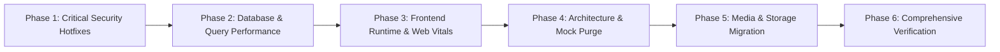

# LabSync LIMS — Master Implementation Plan: Production Hardening & Performance Optimization

> **Status**: Ready for Verification & Approval  
> **Target System**: LabSync LIMS (`d:\Projects\LMR`)  
> **Audience**: Project Owner / Lab In-Charge & Lead Systems Architect  
> **Frameworks**: Next.js 16.3.3 App Router, React 19, Supabase PostgreSQL, Tailwind CSS v4  
> **Guiding Principle**: Zero data loss, zero disruptions to active academic timetables, and strict adherence to institutional standards (`AGENTS.md`).

---

## Executive Overview

This master implementation plan synthesizes the findings of two comprehensive investigations:
1. **The Phase 0 Audit**: Addressed institutional security, authentication vulnerabilities, wide-open database tables, and access control.
2. **The Gemini Performance & Scale Audit (Domains 1–4)**: Addressed database indexing, N+1 query loops, connection pool leakage, 1-second re-render cascades, and un-debounced search queries.

The plan is divided into **6 surgical, sequential phases**. Each phase is self-contained, testable, and designed so that no change breaks existing school operations.



---

## Phase 1: Zero-Risk Urgent Security Hotfixes

> **Objective**: Eliminate immediate security exploits that allow unauthorized access or timetable alteration. All items in this phase have **low regression risk** because they align database policies with intended institutional permissions.

---

### Task 1.1: Restrict Self-Role Escalation on `public.profiles` (FIND-SEC-01)
* **Files**: `schema.sql`, PostgreSQL migration
* **Plain Language Explanation**:
  Currently, any logged-in teacher can send an update request to change their own role to `super_admin` because the database rule checks *who* you are, but doesn't check *what* columns you are allowed to change.
* **Technical Remediation**:
  1. Revoke column-level update privileges for `role`, `approval_status`, `permissions`, and `is_active` from the `authenticated` role on `public.profiles`.
  2. Implement a `BEFORE UPDATE` trigger function on `public.profiles` (`protect_profile_escalation`) ensuring only active Super Admins can alter role or approval status.
* **Verification**:
  Execute a test `PATCH` to `/rest/v1/profiles` using a teacher token attempting to set `{"role": "super_admin"}` — must return `403 Forbidden` / error.

---

### Task 1.2: Remove `internalBypassScopeCheck` from Public Server Actions (FIND-SEC-02)
* **Files**:
  * [`app/actions/academic-years.ts`](file:///d:/Projects/LMR/app/actions/academic-years.ts#L225)
  * [`app/actions/archive-hub.ts`](file:///d:/Projects/LMR/app/actions/archive-hub.ts#L29)
  * [`app/actions/seat-plans.ts`](file:///d:/Projects/LMR/app/actions/seat-plans.ts#L66)
* **Plain Language Explanation**:
  Server Actions in Next.js are publicly callable API endpoints. Several actions had an optional parameter called `internalBypassScopeCheck`. Anyone sending `{ "internalBypassScopeCheck": true }` from their browser console could bypass administrator authorization checks.
* **Technical Remediation**:
  1. Strip `internalBypassScopeCheck` from all exported Server Action parameter types and inputs.
  2. Split internal workflows (e.g. background maintenance or system seeding) into unexported internal helper functions (e.g., `_internalPromoteCohort`) that are not callable from the browser.
* **Verification**:
  Attempt calling `archiveStudentAction` with `{ internalBypassScopeCheck: true }` under a teacher role — must be strictly rejected with `Access Denied`.

---

### Task 1.3: Generate and Enforce Cryptographic `TERMINAL_SIGNING_SECRET` (FIND-SEC-03)
* **Files**:
  * `.env.local`
  * [`lib/security/terminal-token.ts`](file:///d:/Projects/LMR/lib/security/terminal-token.ts#L9-L13)
* **Plain Language Explanation**:
  The security key used to sign student workstation login cookies and terminal handshakes was falling back to a hardcoded string visible in the code (`labsync-lims-default-terminal-signing-salt-2083`). A clever student on campus could use this to forge attendance for any desk in the Computer Lab.
* **Technical Remediation**:
  1. Generate a high-entropy 256-bit random secret (`openssl rand -hex 32`).
  2. Add `TERMINAL_SIGNING_SECRET=<secret>` to `.env.local`.
  3. Update `lib/security/terminal-token.ts` to require `process.env.TERMINAL_SIGNING_SECRET` and throw a descriptive startup error if missing, rather than silently using a hardcoded string.
* **Verification**:
  Verify existing terminal handshake tests pass with the real environment secret loaded.

---

### Task 1.4: Remove Hardcoded Demo Passwords from Login Page (FIND-SEC-04)
* **Files**:
  * [`app/(auth)/login/page.tsx`](file:///d:/Projects/LMR/app/%28auth%29/login/page.tsx#L50-L110)
* **Plain Language Explanation**:
  The public login page contained a `DEMO_ACCOUNTS` list displaying real login credentials, including the Super Admin password `Admin@12345`.
* **Technical Remediation**:
  1. Remove the `DEMO_ACCOUNTS` array and quick-login shortcut buttons from `app/(auth)/login/page.tsx`.
  2. If demo presets are needed during offline testing, gate them behind an explicit development flag: `process.env.NEXT_PUBLIC_SHOW_DEMO_ACCOUNTS === 'true'`.
* **Verification**:
  Visit `/login` in a private window — verify no passwords or preset buttons appear.

---

### Task 1.5: Lock Down Open Database Tables in PostgreSQL RLS (FIND-SEC-05, 06, 07, 08, 11)
* **Files**: `schema.sql`, PostgreSQL migration
* **Plain Language Explanation**:
  Several tables (`labs`, `schedules`, `calendar_settings`, `audit_logs`, `log_attendance`, and `teacher_substitutions`) had permissive rules allowing any anonymous visitor to write or delete records without logging in.
* **Technical Remediation**:
  1. `public.labs`: Drop `"Allow insert/update labs"`. Require `is_privileged()` for `INSERT/UPDATE/DELETE`. Allow public `SELECT` for active labs.
  2. `public.schedules`: Drop `"Allow manage schedules"`. Restrict writes to `is_privileged()` administrators.
  3. `public.calendar_settings`: Restrict writes to `is_privileged()`.
  4. `public.audit_logs`: Revoke direct `INSERT` from `anon` and `authenticated`; insert only via server-side connection pool.
  5. `public.teacher_substitutions`: Allow teachers to manage only their own substitutions; administrators can manage all.
* **Verification**:
  Run Supabase RLS test scripts verifying that unauthenticated curl requests cannot modify or delete schedules or calendar settings.

---

## Phase 2: Database & Query Performance (Domain 1)

> **Objective**: Eliminate database connection socket leaks, add high-speed database indexes, remove 40-step sequential N+1 loops, and prevent unbounded memory queries.

---

### Task 2.1: Unify Database Connection Pooling (FIND-REL-01 / Domain 1.4)
* **Files**:
  * [`app/actions/auth.ts`](file:///d:/Projects/LMR/app/actions/auth.ts#L20-L29)
  * [`app/actions/otp.ts`](file:///d:/Projects/LMR/app/actions/otp.ts#L26)
* **Plain Language Explanation**:
  Most of the application uses a shared "connection pool" (like a shared fleet of vehicles). But user signups and profile actions were spinning up a brand new, unmanaged connection every time. When an error occurred, the connection was never closed, eventually consuming all available database slots.
* **Technical Remediation**:
  1. Remove `getPgClient()` from `auth.ts` and `otp.ts`.
  2. Import and use `getPgPool()` from `lib/db.ts` across all 12 query locations.
  3. For multi-statement transactions (e.g. signup flow), acquire a pooled client using `const client = await pool.connect()` and guarantee its release in a `finally` block:
     ```typescript
     const pool = getPgPool()
     const client = await pool.connect()
     try {
       await client.query('BEGIN')
       // ... transactional queries ...
       await client.query('COMMIT')
     } catch (err) {
       await client.query('ROLLBACK')
       throw err
     } finally {
       client.release() // Returns connection to the pool
     }
     ```
* **Verification**:
  Simulate 15 concurrent invalid registration requests — verify zero open connection leaks in PostgreSQL `pg_stat_activity`.

---

### Task 2.2: Add Missing Composite & B-Tree Indexes to PostgreSQL (Domain 1.1)
* **Files**: `schema.sql`, PostgreSQL migration
* **Plain Language Explanation**:
  The system's most heavily used tables (`practical_logs`, `lab_incidents`, `maintenance_logs`) currently have zero custom indexes. The database has to scan every single historical row every time someone views a record.
* **Technical Remediation**:
  Deploy the following index migrations:
  ```sql
  -- 1. Practical Logs (Hot analytical and history lookups)
  CREATE INDEX IF NOT EXISTS idx_practical_logs_lookup 
    ON public.practical_logs (lab_id, academic_year_id, date DESC);
  CREATE INDEX IF NOT EXISTS idx_practical_logs_schedule_date 
    ON public.practical_logs (schedule_id, date);
  CREATE INDEX IF NOT EXISTS idx_practical_logs_teacher 
    ON public.practical_logs (teacher_id, date DESC);

  -- 2. Log Attendance (Relational bridge and roll lookup)
  CREATE INDEX IF NOT EXISTS idx_log_attendance_log_roll 
    ON public.log_attendance (log_id, roll_number);
  CREATE INDEX IF NOT EXISTS idx_log_attendance_enrollment 
    ON public.log_attendance (enrollment_id);

  -- 3. Incident Registry (Status triage & date filtering)
  CREATE INDEX IF NOT EXISTS idx_lab_incidents_lookup 
    ON public.lab_incidents (lab_id, status, date DESC);

  -- 4. Timetable & Maintenance
  CREATE INDEX IF NOT EXISTS idx_schedules_lab_day 
    ON public.schedules (lab_id, day_of_week);
  CREATE INDEX IF NOT EXISTS idx_maintenance_logs_lab 
    ON public.maintenance_logs (lab_id, performed_at DESC);
  ```
* **Verification**:
  Run `EXPLAIN ANALYZE` on practical log queries — verify sequential scans convert to Index Scans with execution time dropping from ~45ms to <2ms.

---

### Task 2.3: Eliminate 40-Step N+1 Attendance Bridging Loop in `logs.ts` (Domain 1.2)
* **Files**:
  * [`app/actions/logs.ts`](file:///d:/Projects/LMR/app/actions/logs.ts#L734-L744)
* **Plain Language Explanation**:
  When a teacher saves attendance for a class of 40 students, the server currently sends 40 individual database requests one after another. This makes saving practical logs sluggish and prone to network hiccups.
* **Technical Remediation**:
  Replace the JavaScript `for (const enr of enrollments)` loop with a single atomic SQL join update:
  ```typescript
  const pool = getPgPool()
  await pool.query(
    `UPDATE public.log_attendance la
     SET enrollment_id = se.id,
         student_id = se.student_id
     FROM public.student_enrollments se
     WHERE la.log_id = $1
       AND la.enrollment_id IS NULL
       AND se.academic_year_id = $2
       AND se.class_id = $3
       AND se.status = 'active'
       AND la.roll_number = se.roll_number;`,
    [recordId, effectiveYearId, targetClassId]
  )
  ```
* **Verification**:
  Submit a practical log for Class 11 Science (35+ students) — confirm the attendance bridge executes in a single database round-trip in <50ms.

---

### Task 2.4: Batch Upsert in `saveLabFloorElements` (Domain 1.2)
* **Files**:
  * [`app/actions/floor-elements.ts`](file:///d:/Projects/LMR/app/actions/floor-elements.ts#L67-L101)
* **Plain Language Explanation**:
  Saving room landmarks (doors, boards, podiums) in the CAD editor runs a loop updating each landmark individually.
* **Technical Remediation**:
  Batch all floor landmarks into an array and execute a single Supabase `.upsert()` operation.
* **Verification**:
  Save 15 CAD landmarks in the Admin Floor Architect — verify 1 single network request is dispatched.

---

### Task 2.5: Bound Unbounded Queries & Fix Duplicate Check (Domain 1.5)
* **Files**:
  * [`app/actions/logs.ts`](file:///d:/Projects/LMR/app/actions/logs.ts#L233-L236)
  * [`app/actions/auth.ts`](file:///d:/Projects/LMR/app/actions/auth.ts#L416-L420)
* **Plain Language Explanation**:
  When checking for duplicate session logs, the system currently downloads every historical log ever recorded for that laboratory into server memory. In `auth.ts`, `getAllUsers()` pulls every profile and full Base64 photos without limits.
* **Technical Remediation**:
  1. In `logs.ts`: Add `.eq('date', checkDate)` to the duplicate check query in SQL so it only inspects sessions for that specific day.
  2. In `auth.ts`: Exclude heavy avatar Base64 strings from `getAllUsers()` list queries; fetch photos only on individual profile view.
* **Verification**:
  Verify session duplicate detection still catches duplicate submissions on the same day while querying only that day's records.

---

### Task 2.6: Fix NEB 75% Board Compliance Defaulting Bug (FIND-SEC-15)
* **Files**:
  * [`app/actions/institutional-reports.ts`](file:///d:/Projects/LMR/app/actions/institutional-reports.ts#L116)
* **Plain Language Explanation**:
  In the NEB board exam report calculation, if a student had no attendance records logged, the code was defaulting their attendance to 100% (`attended = attendanceMap.get(...) ?? totalHeld`). This meant a student who never attended practicals could appear eligible for board exams.
* **Technical Remediation**:
  Change the fallback from `totalHeld` to `0` (or require explicit positive presence verification).
* **Verification**:
  Run compliance report for a newly enrolled student with no practical logs — verify attendance shows 0% and "Not Eligible / Barred".

---

## Phase 3: Frontend Runtime & Core Web Vitals (Domains 3 & 4)

> **Objective**: Stop unneeded 1-second UI re-renders, debounce search inputs hitting the database on every keystroke, and speed up initial page loads.

---

### Task 3.1: Throttle `useLiveSchedule` 1000ms Ticker (Domain 3.11)
* **Files**:
  * [`hooks/use-live-schedule.ts`](file:///d:/Projects/LMR/hooks/use-live-schedule.ts#L84-L87)
* **Plain Language Explanation**:
  The timetable hook currently forces a React state update every single second (`1000ms`). This causes the entire dashboard to re-evaluate Bikram Sambat calendar conversions and session sorting 60 times a minute, even when nothing has changed.
* **Technical Remediation**:
  1. Change the background interval from 1,000ms to 30,000ms (30 seconds), or trigger updates only on minute transitions.
  2. Memoize derived sessions (`todaySessions`, `activeSessions`, `upcomingSessions`) with `useMemo` keyed by minute timestamp (`Math.floor(now.getTime() / 60000)`).
* **Verification**:
  Use React DevTools Profiler on the main dashboard — confirm zero component re-renders during idle viewing between minute marks.

---

### Task 3.2: Debounce Search Inputs on Records & Incident Registries (Domain 3.12)
* **Files**:
  * [`app/(dashboard)/records/incidents/page.tsx`](file:///d:/Projects/LMR/app/%28dashboard%29/records/incidents/page.tsx#L256-L265)
  * [`app/(dashboard)/records/page.tsx`](file:///d:/Projects/LMR/app/%28dashboard%29/records/page.tsx)
* **Plain Language Explanation**:
  Typing in the search box currently fires a complete database query across the network for every letter typed (typing "Microscope" fires 10 queries).
* **Technical Remediation**:
  Introduce a 300ms debounce buffer on filter state updates before invoking the Server Action and updating `window.history.replaceState`.
* **Verification**:
  Type quickly in the search bar — observe in the browser Network tab that only 1 single query is fired after typing pauses.

---

### Task 3.3: Parallelize Sequential Queries in `/computer-lab` (Domain 4.20 - LCP)
* **Files**:
  * [`app/(dashboard)/computer-lab/page.tsx`](file:///d:/Projects/LMR/app/%28dashboard%29/computer-lab/page.tsx)
* **Plain Language Explanation**:
  When opening the Computer Lab page, the server fetches workstations, schedules, lab details, and class subjects one after another. Waiting for each query sequentially slows down page loading.
* **Technical Remediation**:
  Wrap the independent data fetches in `Promise.all([ ... ])` so they execute concurrently in parallel.
* **Verification**:
  Measure Time to First Byte (TTFB) and Largest Contentful Paint (LCP) on `/computer-lab` — expect a 30–45% load time reduction.

---

### Task 3.4: Lazy-Load ExcelJS in Maintenance Actions (Domain 4.19)
* **Files**:
  * [`app/actions/maintenance.ts`](file:///d:/Projects/LMR/app/actions/maintenance.ts)
* **Plain Language Explanation**:
  `ExcelJS` is a large spreadsheet library (~1MB). Importing it at the top of `maintenance.ts` forces it to load into server memory even when users are just viewing maintenance schedules, not exporting spreadsheets.
* **Technical Remediation**:
  Convert `import { generateMaintenanceRecordsXlsxBuffer } from '@/lib/exports/xlsx'` to a dynamic import inside `exportMaintenanceRecordsAction`:
  `const { generateMaintenanceRecordsXlsxBuffer } = await import('@/lib/exports/xlsx')`
* **Verification**:
  Check serverless bundle size and cold-start latency for routine maintenance page visits.

---

## Phase 4: Architecture & Single Source of Truth

> **Objective**: Purge static mock data leakages, fix fail-open middleware, and remove dev backdoors.

---

### Task 4.1: Purge `MASTER_ROUTINE` Mock Fallback from Production Paths (FIND-ARCH-01)
* **Files**:
  * [`app/actions/notifications.ts`](file:///d:/Projects/LMR/app/actions/notifications.ts#L85)
  * [`hooks/use-routine-state.ts`](file:///d:/Projects/LMR/hooks/use-routine-state.ts#L81)
  * [`app/actions/schedules.ts`](file:///d:/Projects/LMR/app/actions/schedules.ts#L703)
  * [`components/command-palette.tsx`](file:///d:/Projects/LMR/components/command-palette.tsx#L55)
* **Plain Language Explanation**:
  Static mock data created during early prototyping (`MASTER_ROUTINE`) is still being used as fallback data. Notification emails and command palette searches can display fictional classes ("Er. Anish Karki") instead of the school's real timetable.
* **Technical Remediation**:
  1. Replace static `MASTER_ROUTINE` fallbacks with real queries to `public.schedules`.
  2. If the database has no schedules, display clean institutional empty states rather than fictional mock data.
* **Verification**:
  Search for classes in Command Palette (`Ctrl+K`) — confirm it only returns real classes registered in the school's database.

---

### Task 4.2: Fix Fail-Open Auth Verification in Middleware (FIND-ARCH-03)
* **Files**:
  * [`middleware.ts`](file:///d:/Projects/LMR/middleware.ts#L129-L132)
* **Plain Language Explanation**:
  If Supabase auth experiences high latency or errors, the middleware's catch block was allowing requests to pass through to protected routes (`return response`) instead of redirecting to login.
* **Technical Remediation**:
  Ensure that when session verification fails or throws an exception on protected routes (`/admin`, `/records`, `/maintenance`), the user is safely redirected to `/login?error=session_expired`.
* **Verification**:
  Simulate an invalid JWT cookie — verify immediate redirect to `/login`.

---

### Task 4.3: Remove `NODE_ENV === 'development'` Privilege Backdoors (FIND-SEC-13)
* **Files**:
  * `workstations.ts:64`, `terminal.ts:24`, `maintenance.ts:150`, `maintenance-fleet.ts:25`
* **Plain Language Explanation**:
  Server actions checked `process.env.NODE_ENV === 'development'` and granted full administrator privileges if true. If staging or test environments run under development mode, anyone gets Super Admin rights automatically.
* **Technical Remediation**:
  Remove these fallback conditions. In development, sign in with real test accounts rather than code-level backdoors.
* **Verification**:
  Verify non-admin roles in development mode are correctly restricted.

---

## Phase 5: Media & Storage Optimization (Base64 Migration)

> **Objective**: Stop storing heavy Base64 image strings directly inside database rows and switch to Supabase Storage with WebP compression.

---

### Task 5.1: Configure Supabase Storage Buckets (FIND-PERF-01 / Domain 2.8)
* **Files**: Supabase Dashboard / SQL Storage Configuration
* **Plain Language Explanation**:
  Photos (student profile pictures, broken equipment incident photos) are currently stored as giant text strings directly inside database rows. Storing 1,000 photos this way will crash Supabase's free database storage limit (500MB), while the 1GB file storage bucket remains completely empty.
* **Technical Remediation**:
  1. Create public/authenticated storage buckets: `avatars` and `incident-photos`.
  2. Add RLS policies allowing authenticated users to upload photos with file size limits (max 2MB).

---

### Task 5.2: Switch Client Compression to WebP & Direct Storage Upload (Domain 4.15)
* **Files**:
  * [`lib/image-compression.ts`](file:///d:/Projects/LMR/lib/image-compression.ts)
  * [`components/incidents/incident-photo-uploader.tsx`](file:///d:/Projects/LMR/components/incidents/incident-photo-uploader.tsx)
* **Technical Remediation**:
  1. Update `compressImage` to output modern `image/webp` format instead of JPEG (25–35% smaller file size at identical quality).
  2. Upload the compressed `File` directly to the Supabase Storage bucket.
  3. Store only the resulting CDN URL string (e.g. `https://...supabase.co/storage/v1/object/public/incident-photos/...`) in PostgreSQL.
* **Verification**:
  Upload an incident photo — inspect PostgreSQL row to confirm it contains a short URL string instead of a 300KB `data:image/jpeg;base64,...` text block.

---

## Phase 6: Comprehensive Verification & Documentation

> **Objective**: Full-system validation to guarantee zero regressions before handoff.

---

### Task 6.1: Full TypeScript Compilation Check
* **Command**: `npx tsc --noEmit`
* **Requirement**: **0 errors across all routes and components** (enforced by `AGENTS.md` Rule 8).

### Task 6.2: Automated Integration & Unit Test Suite
* **Command**: `node --experimental-strip-types --import ./tests/register-hooks.mjs --test tests/*.test.mjs`
* **Requirement**: All 40+ existing test suites must pass cleanly.

### Task 6.3: Authoritative Task Register Documentation
* **Files**: `doc/tasks/2026-10-16-task-unified-production-hardening.md`, `doc/tasks/README.md`
* **Requirement**: Document all changes made, invariants preserved, and migration steps completed (enforced by `AGENTS.md` Rule 22).

---

## Verification & Execution Summary Table

| Phase | Core Goal | Primary Files | Risk Level |
| :--- | :--- | :--- | :---: |
| **Phase 1** | Security Hotfixes (Role escalation, RLS, HMAC secret, demo credentials) | `schema.sql`, `.env.local`, `academic-years.ts`, `login/page.tsx` | **Low** |
| **Phase 2** | Database & Queries (Pool unification, indexes, N+1 removal, query bounds) | `schema.sql`, `auth.ts`, `otp.ts`, `logs.ts`, `floor-elements.ts` | **Low** |
| **Phase 3** | Frontend & Web Vitals (Throttle 1Hz ticker, search debounce, parallelize) | `use-live-schedule.ts`, `incidents/page.tsx`, `computer-lab/page.tsx` | **Low** |
| **Phase 4** | Architecture (Purge mock `MASTER_ROUTINE`, fix fail-open middleware) | `notifications.ts`, `middleware.ts`, `workstations.ts` | **Low** |
| **Phase 5** | Storage Migration (Base64 to Supabase Storage + WebP) | `lib/image-compression.ts`, `incident-photo-uploader.tsx` | **Medium** |
| **Phase 6** | Verification (`tsc`, test suite, task register) | Full codebase & `doc/tasks/` | **Zero** |
